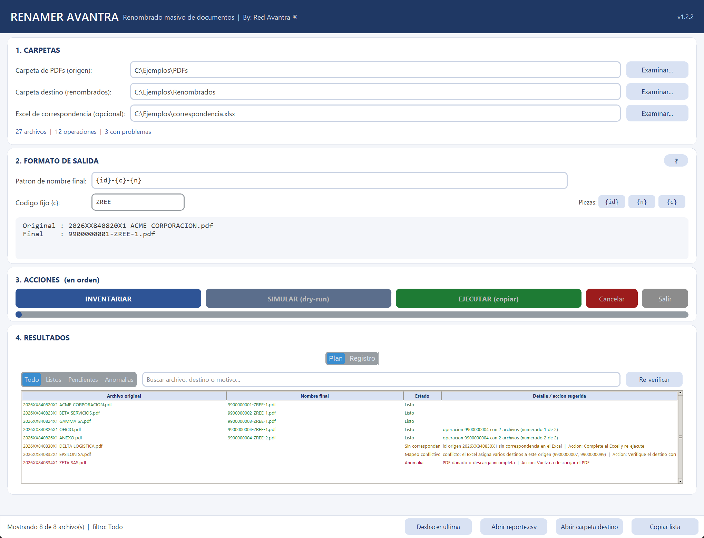
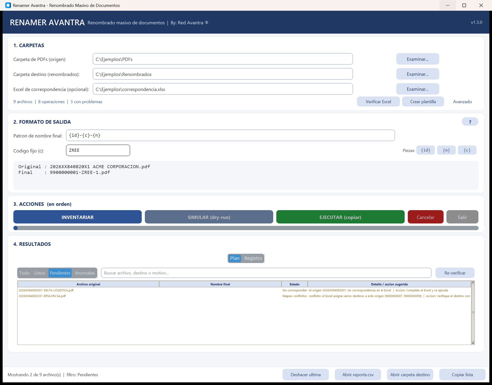
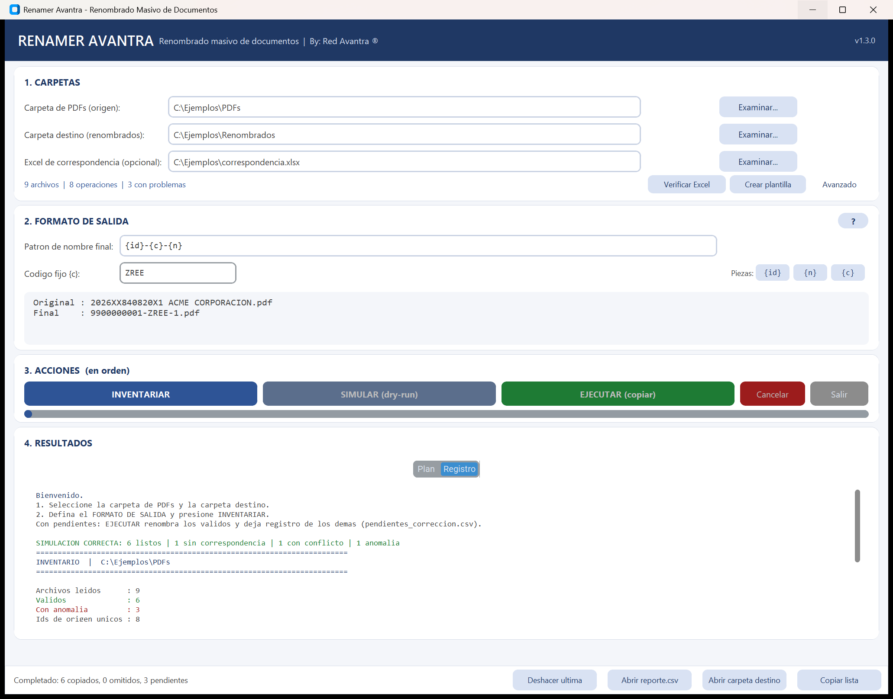
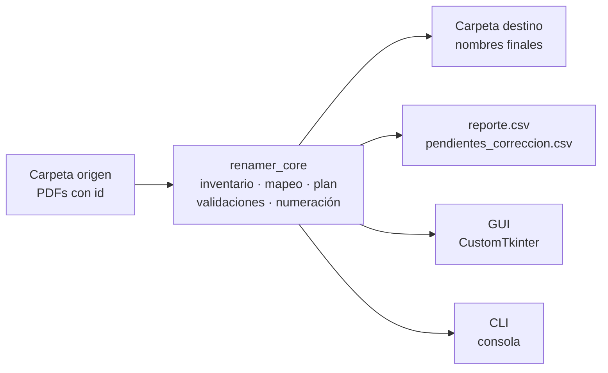

# Renamer Avantra

**Renombrado masivo de documentos PDF con formato de salida configurable**

[](https://github.com/pruebadedireccion/renamer-avantra/actions/workflows/ci.yml)
[](https://github.com/pruebadedireccion/renamer-avantra/releases)
[](LICENSE)
[](https://www.python.org/)

*By: Red Avantra ®*

---

## El problema

En muchos procesos documentales los archivos llegan con un identificador
de origen (por ejemplo, un número de radicado) y el sistema de destino
exige otro formato de nombre. Renombrar cientos o miles de PDFs a mano
es lento, propenso a errores y difícil de auditar.

**Renamer Avantra** resuelve ese paso intermedio: toma los PDFs y una
tabla de correspondencia en Excel, y genera los archivos con el nombre
exacto que exige el sistema de destino, con simulación previa,
trazabilidad y seguimiento de pendientes.



## Características

**Formato de salida configurable**

- Plantilla de tokens: `{id}`, `{n}` y `{c}`
- Ejemplo en vivo de la transformación mientras se edita el patrón
- Validación en tiempo real (tokens, orden y presencia obligatoria de `{id}`)
- La configuración se conserva entre sesiones

**Control del proceso**

- Simulación completa (dry-run) antes de copiar nada
- Tabla de resultados con filtros (todo / listos / pendientes / anomalías),
  buscador y pestaña de registro detallado
- Cancelación de procesos largos
- Deshacer la última ejecución (solo copias registradas en el reporte)
- Arrastrar y soltar carpetas o el Excel sobre la ventana

**Seguridad de los datos**

- Detección de mapeos conflictivos: si el Excel asigna dos destinos
  distintos al mismo identificador, esos archivos quedan pendientes en
  lugar de ir a la operación equivocada
- Validación del contenido de los PDFs (encabezado `%PDF`): detecta
  archivos dañados o descargas incompletas
- Anomalías detectadas antes de copiar (duplicados de descarga, nombres
  fuera de patrón)
- Operación no destructiva: los originales nunca se modifican

**Trazabilidad**

- `reporte.csv` por ejecución: archivo original, nombre final, estado y detalle
- `pendientes_correccion.csv`: motivo y acción sugerida por cada archivo que
  no se pudo renombrar
- `ids_pendientes.txt`: identificadores sin correspondencia, listos para
  re-consultar
- Re-ejecución segura: los archivos ya renombrados se omiten solos

## Capturas

| Resultados filtrados por pendientes | Registro de una ejecución |
|---|---|
|  |  |

## Formato de salida: cómo funciona

| Patrón | Resultado | Cuándo usarlo |
|---|---|---|
| `{id}` | `9900000001.pdf` | Operaciones de un solo documento |
| `{id}-{n}` | `9900000001-1.pdf` | Numeración explícita siempre |
| `{id}-{c}-{n}` | `9900000001-ZREE-1.pdf` | Con código de formato |

- `{id}`: identificador de destino (viene del Excel de correspondencia)
- `{n}`: consecutivo automático cuando una operación recibe varios archivos
  (orden alfabético del nombre original)
- `{c}`: código fijo configurable (por ejemplo `ZREE`)

Si una operación de destino recibe un solo archivo, `{n}` vale 1 y el
patrón produce un único nombre. Si recibe varios, se numeran 1, 2, 3...

## Entrada esperada

```
carpeta_origen/
├── 2026XX840820X1 ACME CORPORACION.pdf
├── 2026XX840823X1 BETA SERVICIOS.pdf
└── ...
```

Los nombres deben iniciar con el identificador de origen (por defecto:
4 dígitos + 2 letras + números + 1 letra + 1 dígito). El Excel de
correspondencia contiene dos columnas; la aplicación detecta cuál es cuál
por su contenido, sin importar el orden ni el título:

| ID de origen | ID de destino |
|---|---|
| 2026XX840820X1 | 9900000001 |
| 2026XX840823X1 | 9900000002 |

## Flujo de uso

```
1. INVENTARIAR -> valida nombres y genera ids_para_consulta.txt
2. (manual)    -> consulta los identificadores y descarga el Excel
3. SIMULAR     -> muestra el plan completo sin modificar nada
4. EJECUTAR    -> copia los archivos renombrados + reporte.csv
5. (manual)    -> carga la carpeta destino en el sistema de destino
```

La lista de identificadores se genera en lotes de 200 para consultas que
limitan el volumen por búsqueda.

## Uso — Interfaz gráfica

Descarga el ejecutable portable desde
[Releases](https://github.com/pruebadedireccion/renamer-avantra/releases)
y haz doble clic (no requiere instalación ni permisos de administrador).
La primera vez Windows puede mostrar el aviso de SmartScreen:
*Más información → Ejecutar de todas formas*.

Desde el código:

```bash
python src/renamer_gui.py
```

## Uso — Consola (CLI)

```bash
# 1. Inventario + lista de identificadores (no modifica nada)
python src/renamer_cli.py --carpeta CARPETA

# 2. Simulación con el Excel de correspondencia (dry-run)
python src/renamer_cli.py --carpeta CARPETA --mapeo mapeo.xlsx

# 3. Renombrado real (copia a carpeta destino)
python src/renamer_cli.py --carpeta CARPETA --mapeo mapeo.xlsx \
       --destino SALIDA --ejecutar

# Formato de salida personalizado
python src/renamer_cli.py --carpeta CARPETA --mapeo mapeo.xlsx \
       --patron "{id}-{c}-{n}" --codigo ZREE --ejecutar
```

## Arquitectura



La lógica vive en un único módulo probado (`renamer_core.py`) y las
interfaces (`renamer_gui.py` y `renamer_cli.py`) solo la presentan. Esto
garantiza que la GUI y la consola se comporten exactamente igual.

## Seguridad de la información

- **Procesamiento 100 % local:** la aplicación no tiene conexión a red,
  no envía telemetría y no descarga recursos externos.
- **No destructiva:** solo copia; los archivos originales nunca se borran
  ni se modifican.
- **Confirmación explícita:** toda copia exige confirmación previa y todo
  destino ya existente se omite (nunca se sobrescribe).
- **Doble validación:** simulación completa antes de ejecutar y bloqueo
  ante colisiones de nombre.
- **Deshacer con verificación:** elimina únicamente copias registradas en
  el `reporte.csv`, comprobando tamaño contra el original.
- **Trazabilidad auditable:** cada ejecución deja evidencia en CSV.
- **Ejecutable sin permisos:** no requiere administrador ni instalación.

## Privacidad y datos

- El repositorio contiene únicamente **datos ficticios** (`ACME`,
  `2026XX…`, `9900000…`): no hay información personal ni de clientes.
- El archivo de configuración `config.json` es local y está excluido del
  repositorio.
- Las capturas de este README usan rutas y datos de ejemplo.

## Calidad y pruebas

- **24 pruebas automatizadas** (pytest) sobre inventario, mapeo, plan,
  numeración, validaciones, ejecución parcial, cancelación, deshacer y
  traducción de errores.
- **Integración continua** con GitHub Actions en Windows (Python 3.11 y 3.12).
- Ejecutar localmente:

```bash
pip install -r requirements.txt pytest
pytest tests -q
```

## Instalación (modo desarrollo)

```bash
git clone https://github.com/pruebadedireccion/renamer-avantra.git
cd renamer-avantra
pip install -r requirements.txt
python src/renamer_gui.py
```

Requisitos: Windows y Python 3.11 o superior.

## Stack tecnológico

| Tecnología | Uso |
|---|---|
| Python 3.11+ | Lógica de negocio |
| CustomTkinter | Interfaz gráfica |
| openpyxl | Lectura del Excel de correspondencia |
| tkinterdnd2 | Arrastrar y soltar (opcional) |
| Expresiones regulares | Validación de identificadores |
| PyInstaller | Empaquetado portable (Release) |
| pytest + GitHub Actions | Pruebas e integración continua |

## Historial de cambios

Ver [CHANGELOG.md](CHANGELOG.md).

## Seguridad

Para reportar vulnerabilidades, ver [SECURITY.md](SECURITY.md).

## Autor

**Daniel Mauricio Reina Diaz** — *Red Avantra ®*

- GitHub: [@pruebadedireccion](https://github.com/pruebadedireccion)

## Licencia

MIT — ver [LICENSE](LICENSE).